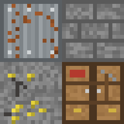

# RustCraft — сервер Minecraft Bedrock «как Rust»

Сервер на выживание для Minecraft Bedrock (телефоны, планшеты, Windows, консоли) по мотивам Rust:
залежи камня, металла и серы, шкаф с инструментами, постройки с прочностью, рейды на C4,
самодельное огнестрельное оружие, спальники и случайный спавн.



## Какой сервер выбран и почему

**Bedrock Dedicated Server (BDS)** — официальный сервер от Mojang, плюс собственный аддон **RustCraft**
(behavior pack со скриптами + resource pack с текстурами).

- Игроки с телефона заходят напрямую, без Geyser и прокси, и сразу получают текстуры с сервера.
- BDS выходит в день обновления игры, поэтому не бывает ситуации «сервер не пускает новую версию».
- Сторонние плагины не нужны: «плагины» — это скрипты в `packs/RustCraft_BP/scripts/plugins/`,
  они работают на официальном Script API (`@minecraft/server` 2.4.0) и **не требуют экспериментальных
  настроек мира**.

PocketMine-MP и Nukkit тоже бывают на Bedrock, но для них нужны неофициальные плагины-«костыли»
(Customies и подобные), чтобы добавлять свои блоки и текстуры, и после каждого обновления
Minecraft приходится ждать, пока их обновят. Для сервера, где главное — свои блоки, BDS с аддоном надёжнее.

## Плагины (что уже написано)

| Плагин | Файл | Что делает |
|---|---|---|
| Шкаф (TC) | `toolCupboard.js` | Зона 33×33×49 блоков вокруг шкафа. Без авторизации нельзя строить, ломать, открывать двери, сундуки и печи. Любой, кто добрался до шкафа, может авторизоваться (как в Rust). Меню: авторизоваться / выписаться / очистить список |
| Рейды | `raid.js` | У построек и дверей есть HP. Ломают их только **сумка с зарядом** и **C4**; ванильный TNT и криперы их не берут. C4 взрывается через 10 с, сумка — через 4–8 с, с шансом осечки 20% |
| Строительство | `building.js` | Киянкой улучшаешь постройку: солома → дерево → камень → листовой металл → МВК. Её же можно починить после рейда |
| Добыча | `gathering.js` | Вокруг игроков появляются залежи камня, металла и серы, бочки и военные ящики. Сколько выпадет, зависит от инструмента (камень, каменная кирка, кирка). Рубка топором даёт «Дерево», а с травы иногда падает ткань |
| Крафт | `crafting.js` + `recipes.js` | Меню крафта как в Rust (кнопки с иконками, удобно на телефоне). Верстаки 1–3 уровня открывают новые рецепты |
| Оружие и медицина | `combat.js` | Револьвер, самодельный дробовик (6 дробин), полуавтоматическая винтовка с патронами. Бинт и шприц |
| Спавн | `spawn.js` | Случайный спавн на карте, при каждом возрождении — камень, факел и меню крафта. После смерти можно выбрать спальник (с перезарядкой) |
| Переработчик | `recycler.js` | Трубы, пружины, шестерёнки → скрап, МВК, фрагменты металла |
| HUD | `hud.js` | Надпись «Строительство разрешено/запрещено» в зоне шкафа |
| Команды | `commands.js` | `/rust:info`, `/rust:craft`, `/rust:tc`, `/rust:admin on/off`, `/rust:wipe` |

Все числа (HP, урон C4, радиус шкафа, добыча, лут, скорость пуль, кит) лежат в
`packs/RustCraft_BP/scripts/config.js`, рецепты — в `packs/RustCraft_BP/scripts/recipes.js`.

## Контент и текстуры

Все текстуры 16×16 сделаны в пиксель-арте генератором `tools/gen_textures.py`, их можно перерисовать.

- **Залежи:** каменная, металлическая (руда + иногда руда МВК), серная.
- **Ресурсы:** дерево, камни, металлическая руда → фрагменты металла, серная руда → сера,
  руда МВК → МВК, ткань, скрап, труба, пружина, шестерёнки, взрывчатка. Руды плавятся в обычной печи.
- **Блоки:** шкаф с инструментами, верстаки 1/2/3, спальный мешок, переработчик, бочка, военный ящик,
  постройки 5 уровней (солома, дерево, камень, листовой металл, МВК).
- **Инструменты:** камень, каменный топор и кирка, топор, кирка, киянка, деревянное копьё.
- **Оружие:** револьвер, самодельный дробовик, полуавтоматическая винтовка + 3 вида патронов.
- **Взрывчатка:** сумка с зарядом, C4.
- **Медицина:** бинт, медицинский шприц.

### Сколько взрывчатки нужно на рейд

| Постройка | HP | Сумок | C4 |
|---|---|---|---|
| Солома | 10 | 1 | 1 |
| Дерево / деревянная дверь | 250 / 200 | 4 / 3 | 1 |
| Камень | 500 | 7 | 2 |
| Листовой металл / железная дверь | 1000 / 400 | 14 / 6 | 4 / 2 |
| МВК | 2000 | 27 | 8 |
| Шкаф | 100 | 2 | 1 |

### Путь игрока

1. Появляешься в случайном месте с камнем и факлом. Бьёшь залежи и деревья.
2. В меню крафта (книга в инвентаре): каменная кирка и топор, «Постройка: солома», шкаф, спальник.
3. Ставишь солому, сразу шкаф, улучшаешь стены киянкой. Дверь — железная, открывается кнопкой
   (без авторизации в шкафу кнопку не нажать).
4. Плавишь руду, собираешь скрап из бочек → верстак 1 → оружие и сумки.
5. Верстак 2 → 3 → C4 и рейды.

## Установка

### Вариант A — VPS или домашний ПК на Linux (рекомендуется)

Подойдёт любой VPS от 2 ГБ ОЗУ (на 10–20 игроков лучше 4 ГБ), Ubuntu 22.04/24.04.

```bash
sudo apt install -y git curl unzip python3
git clone <этот репозиторий> rustcraft && cd rustcraft
./scripts/install.sh      # скачает BDS с minecraft.net, поставит аддон и настройки
./scripts/start.sh        # запуск (лучше внутри screen/tmux)
```

Откройте порт **19132/UDP** в фаерволе (`sudo ufw allow 19132/udp`). Если сервер дома, пробросьте
этот же порт на роутере.

Обновление после выхода новой версии Minecraft: `UPDATE=1 ./scripts/install.sh`. Мир и настройки сохранятся.

### Вариант B — Docker

```bash
docker compose up -d
```

Используется образ `itzg/minecraft-bedrock-server`, мир хранится в `./data`.

### Вариант C — Windows

1. Скачайте «Bedrock Dedicated Server» для Windows с minecraft.net/download/server/bedrock и распакуйте.
2. Скопируйте `packs/RustCraft_BP` в `behavior_packs/`, а `packs/RustCraft_RP` в `resource_packs/`.
3. Создайте папку `worlds/RustCraft/` и положите в неё оба файла из `server/worlds/RustCraft/`.
4. Перенесите в `server.properties` значения из `server/server.overrides` (главное: `level-name=RustCraft`
   и `texturepack-required=true`) и запустите `bedrock_server.exe`.

### Как зайти с телефона

Minecraft → «Играть» → «Серверы» → «Добавить сервер»: адрес — IP сервера, порт — `19132`.
Текстуры скачаются автоматически при первом входе.

Проверить аддон без сервера: `./scripts/build-mcaddon.sh` соберёт `dist/RustCraft.mcaddon`.
Откройте его на телефоне и включите оба пакета в настройках одиночного мира.

## Администрирование

- Выдать права оператора: в консоли сервера `op <ник>`.
- `/rust:admin on`: шкафы на вас не действуют, можно чинить и разбирать любые базы. Требует права оператора.
- Переработчики ставятся на «монументах» вручную: в консоли `give <ник> rust:recycler`.
  Сломать их нельзя.
- Вайп: остановите сервер, удалите `server/bds/worlds/RustCraft/db` и `level.dat`
  (файлы `world_*_packs.json` не трогайте) и запустите сервер. `/rust:wipe` очищает только данные
  RustCraft (шкафы, HP, спальники) без удаления карты.
- Логи скриптов пишутся в консоль сервера с префиксом `[RustCraft]`.

## Структура репозитория

```
packs/RustCraft_BP/     behavior pack: блоки, предметы, рецепты печи, скрипты-плагины
  scripts/config.js     все настройки баланса
  scripts/recipes.js    рецепты меню крафта
  scripts/plugins/      плагины (каждый можно отключить в scripts/main.js)
packs/RustCraft_RP/     resource pack: текстуры, модели спальника и зарядов
server/server.overrides настройки server.properties
server/worlds/RustCraft привязка паков к миру
scripts/                установка, запуск, сборка .mcaddon
tools/gen_textures.py   генератор текстур
docker-compose.yml      запуск в Docker
```

## Что можно добавить потом

- Отдельные формы построек (полублоки-полы, стены в полблока, дверные проёмы) — нужны свои 3D-модели.
- Автомат с зажатием спуска и ракетница — нужны свои сущности-снаряды.
- Гниение баз без ресурсов в шкафу (upkeep).
- Монументы: структуры с переработчиком и военными ящиками.
